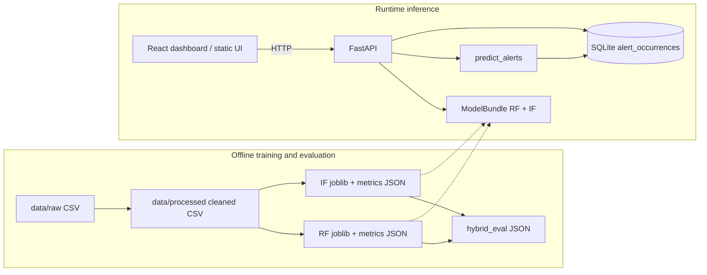
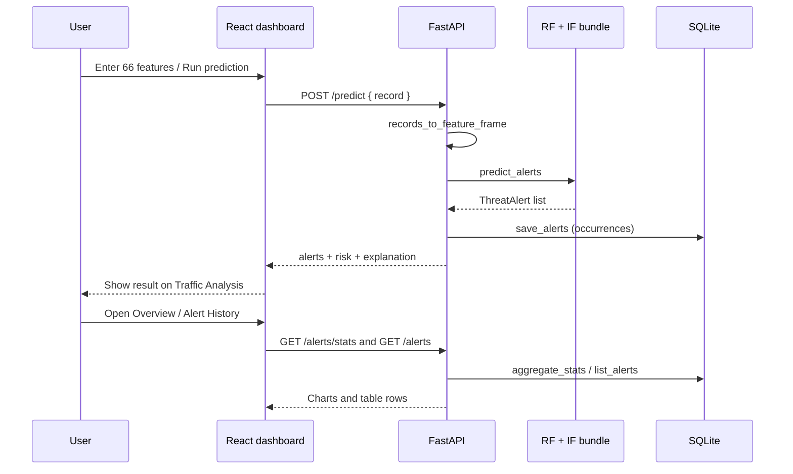

# ThreatLens architecture

This document describes the **implemented** ThreatLens research prototype as it exists in this repository. It does not describe planned features (authentication, live packet capture, traffic blocking, or automated retraining) as if they were complete.

Related reading: [README](../README.md), [evaluation report](EVALUATION.md).

---

## 1. Project purpose and scope

ThreatLens is a final-year research prototype for **hybrid machine-learning intrusion detection** on recorded network-flow features. It turns a flow feature vector into:

1. Supervised Random Forest and unsupervised Isolation Forest predictions.
2. A rule-based hybrid decision (`BENIGN`, `SUSPICIOUS`, or `DDoS`).
3. A heuristic risk score and textual explanation.
4. Optional persistence of that alert occurrence in SQLite.
5. Display via a FastAPI static UI and a React dashboard.

**In scope today**

- Offline CICIDS-style CSV preprocessing and train/val/test evaluation.
- Saved RF and IF artifacts under `artifacts/models/`.
- Inference API and alert history.
- React dashboard (Overview, Alert History, Traffic Analysis, About).

**Out of scope (not implemented)**

- Authentication or multi-user access control.
- Live packet capture or inline blocking.
- Drift detection or automated retraining loops.
- Claiming that `/health` readiness equals detection accuracy.

---

## 2. High-level architecture



Training scripts write artifacts once. The API loads those artifacts at startup and never accepts client-supplied model or database paths.

---

## 3. Dataset ingestion and preprocessing

| Stage | Location | Behaviour |
| --- | --- | --- |
| Raw placement | `data/raw/` | Large recorded CSVs (gitignored). Not overwritten by cleaning. |
| Load | `threatlens.data.load` / `dataset.load_csv` | Read CSV into a DataFrame. |
| Clean | `threatlens.data.clean` | Strip header whitespace; drop non-finite numeric rows; drop exact duplicate rows; write cleaned copy under `data/processed/`. |
| Features | `threatlens.data.features.prepare_features_labels` | Exclude `Label`; by default exclude `Destination Port` and duplicate `Fwd Header Length.1`; keep numeric columns. |
| Split | `threatlens.data.split.split_xy` | Stratified holdout with seed `42`: 20% test, then 20% of the remainder as validation (~64% / 16% / 20%). |
| Constants | `filter_splits_drop_constants` | Drop zero-variance columns learned from **training only**, then apply the same filter to val/test. |

The saved baselines use **66** features after policy exclusions and train-constant drops (see evaluation metrics JSON).

---

## 4. Random Forest classification

| Item | Implementation |
| --- | --- |
| Module | `src/threatlens/models/baseline_rf.py` |
| Train script | `scripts/train_rf_baseline.py` |
| Artifact | `artifacts/models/rf_baseline_ddos_friday.joblib` |
| Metrics | `artifacts/models/rf_baseline_ddos_friday_metrics.json` |
| Defaults | `n_estimators=100`, `max_depth=20`, seed `42` |
| Labels | Binary `BENIGN` / `DDoS` (positive class for FPR = `DDoS`) |
| Fit scope | Training split only |

The classifier emits a class label per row and, when available, an uncalibrated `predict_proba` P(DDoS) used only as a small risk-score adjustment—not as a calibrated attack probability.

---

## 5. Isolation Forest anomaly detection

| Item | Implementation |
| --- | --- |
| Module | `src/threatlens/models/isolation_forest.py` |
| Train script | `scripts/train_if_baseline.py` |
| Artifact | `artifacts/models/if_baseline_ddos_friday.joblib` |
| Metrics | `artifacts/models/if_baseline_ddos_friday_metrics.json` |
| Defaults | `n_estimators=100`, `contamination=0.1`, seed `42` |
| Fit scope | `X_train` only; **labels are not used for fit** |
| Outputs | `normal` / `anomaly`, plus `decision_function` scores (higher = more normal) |

`contamination=0.1` is an Isolation Forest hyperparameter (expected outlier proportion for the algorithm). It is **not** the true attack rate in the dataset.

Offline evaluation maps `anomaly→DDoS` and `normal→BENIGN` only as a **proxy** for comparing against labels. At runtime, anomalies are never silently promoted to confirmed `DDoS` by the hybrid policy.

---

## 6. Hybrid decision policy

Module: `src/threatlens/models/hybrid.py` (`fuse_predictions`).

| RF | IF | Final decision | Meaning in code |
| --- | --- | --- | --- |
| DDoS | anomaly | `DDoS` | Both flagged |
| DDoS | normal | `DDoS` | Supervised flag stands |
| BENIGN | anomaly | `SUSPICIOUS` | Unusual, not confirmed DDoS |
| BENIGN | normal | `BENIGN` | Neither flagged |

`SUSPICIOUS` is **not** converted to `DDoS`. For binary comparison with ground truth, `hybrid_to_binary_label` maps `SUSPICIOUS` → `BENIGN` and reports the suspicious rate separately (`scripts/eval_hybrid.py`).

---

## 7. Risk scoring and explainable alerts

Module: `src/threatlens/models/alerts.py`.

**Risk score (heuristic, 0–100)**

1. Decision base: `BENIGN=20`, `SUSPICIOUS=55`, `DDoS=85`.
2. Optional uncalibrated RF P(DDoS): add `10 * (p - 0.5)`.
3. Optional IF `decision_function` score: add `clip(-10 * score, -10, 10)`.
4. Clip to `[0, 100]`.

Isolation Forest contamination is intentionally unused in scoring.

**Alert fields** include `alert_id` (content hash), `final_decision`, both model predictions, `risk_score`, `explanation`, `reason`, `supporting_scores`, `score_components`, `model_identifiers`, and `notes`.

End-to-end chaining: `predict_alerts` in `src/threatlens/models/inference.py`
(`X → RF.predict → IF.predict_anomalies → fuse_predictions → build_alert`).

---

## 8. FastAPI endpoints and model loading

| Piece | Location |
| --- | --- |
| App factory | `src/threatlens/api/app.py` (`create_app`) |
| Schemas | `src/threatlens/api/schemas.py` |
| Validation | `src/threatlens/api/validation.py` |
| Model load | `src/threatlens/api/state.py` (`load_model_bundle`) |

**Endpoints**

| Method | Path | Role |
| --- | --- | --- |
| GET | `/` | Static investigation UI (`src/threatlens/web/`) |
| GET | `/health` | Models + database readiness (not accuracy) |
| GET | `/schema` | Feature names required by loaded models |
| POST | `/predict` | Validate features → `predict_alerts` → persist → return alerts |
| GET | `/alerts` | Paginated history (`limit` ≤ 200) with `total` |
| GET | `/alerts/stats` | Full-database decision and risk-bucket aggregates |
| GET | `/alerts/{record_id}` | Single occurrence by SQLite primary key |

**Artifact resolution** (server-side only):

- `THREATLENS_RF_ARTIFACT` or default `artifacts/models/rf_baseline_ddos_friday.joblib`
- `THREATLENS_IF_ARTIFACT` or default `artifacts/models/if_baseline_ddos_friday.joblib`

RF and IF feature schemas must match or loading fails. CORS allows only `http://127.0.0.1:5173` and `http://localhost:5173`.

---

## 9. SQLite alert persistence

| Piece | Location |
| --- | --- |
| Store | `src/threatlens/persistence/sqlite_store.py` |
| Default path | `artifacts/threatlens_alerts.sqlite3` |
| Override | `THREATLENS_DB_PATH` |

Each successful prediction inserts one or more **occurrence** rows. The content-hash `alert_id` is stored for correlation but is **not** the primary key (`record_id` is), so identical predictions can be recorded more than once.

`aggregate_stats()` powers Overview charts over the **full** database (not a truncated page). Access to the shared connection is serialized with a lock because FastAPI runs sync routes in a thread pool.

Invalid predict requests never reach persistence.

---

## 10. React frontend and API communication

| Piece | Location |
| --- | --- |
| App entry | `frontend/index.html` → `frontend/src/main.jsx` |
| Routes | `frontend/src/App.jsx` |
| API client | `frontend/src/services/api.js` |
| Dev proxy | `frontend/vite.config.js` |

**Pages**

- **Overview** — `getAlertStats()` + recent `listAlerts(8)`; decision/risk charts from full-DB stats.
- **Alert History** — paginated `listAlerts`; detail via `getAlert(record_id)`.
- **Traffic Analysis** — `getSchema()` drives the form; `predictRecord` calls `POST /predict`.
- **About** — purpose and stated limitations.

In development, unset `VITE_API_BASE_URL` uses the Vite proxy to `127.0.0.1:8000`. Production builds default to `http://127.0.0.1:8000` unless overridden (see `frontend/.env.example`).

---

## 11. Data flow from network-flow input to displayed alert



Training and evaluation use the cleaned CSV offline. Runtime inference accepts **one or more feature records** already shaped like the model schema; it does not capture packets from the wire.

---

## 12. Important source directories and files

```
IDS/
├── src/threatlens/
│   ├── data/           # load, clean, schema, features, split
│   ├── models/         # RF, IF, hybrid, alerts, inference, metrics
│   ├── api/            # FastAPI app, schemas, state, validation
│   ├── persistence/    # SQLite alert store
│   └── web/            # Static investigation UI
├── scripts/            # train_rf_baseline, train_if_baseline, eval_hybrid
├── tests/              # unit + API + integration workflow
├── frontend/           # React dashboard (Vite)
├── data/raw|processed/ # Local CSVs (large files gitignored)
├── artifacts/models/   # joblib + metrics JSON (gitignored weights)
└── docs/               # ARCHITECTURE.md, EVALUATION.md
```

---

## 13. Model artifact and database locations

| Asset | Path |
| --- | --- |
| Random Forest | `artifacts/models/rf_baseline_ddos_friday.joblib` |
| RF metrics | `artifacts/models/rf_baseline_ddos_friday_metrics.json` |
| Isolation Forest | `artifacts/models/if_baseline_ddos_friday.joblib` |
| IF metrics | `artifacts/models/if_baseline_ddos_friday_metrics.json` |
| Hybrid evaluation | `artifacts/models/hybrid_eval_ddos_friday.json` |
| Alert database | `artifacts/threatlens_alerts.sqlite3` (override with `THREATLENS_DB_PATH`) |

`.joblib` files and `*.sqlite3` are gitignored; local copies are required to run inference against the trained baselines.

---

## 14. How to start the backend and frontend

**API (also serves the static UI at `/`)**

```powershell
cd C:\Users\mr\IDS
.\.venv\Scripts\python.exe -m pip install -e ".[dev]"
.\.venv\Scripts\python.exe -m uvicorn threatlens.api.app:app --host 127.0.0.1 --port 8000
```

**React dashboard**

```powershell
cd C:\Users\mr\IDS\frontend
node "C:\Program Files\nodejs\node_modules\npm\bin\npm-cli.js" install
node "C:\Program Files\nodejs\node_modules\npm\bin\npm-cli.js" run dev
```

Open [http://127.0.0.1:5173/](http://127.0.0.1:5173/) for the dashboard and [http://127.0.0.1:8000/docs](http://127.0.0.1:8000/docs) for OpenAPI.

More detail: [README](../README.md).

---

## 15. Security considerations and limitations

**Implemented safeguards**

- Clients cannot choose model file paths or database paths.
- Predict rejects missing/extra features, non-numeric values, NaN, and infinities.
- CORS is restricted to the Vite development origins listed above.
- Failed validation does not write alerts.

**Honest limitations**

- Research prototype on a **DDoS-heavy CICIDS2017 subset**, not a production SOC platform.
- No authentication, authorization, TLS termination, or multi-tenant isolation in-app.
- No live capture or prevention; analysis is offline / API-submitted features.
- Isolation Forest anomalies are unusual patterns, not proven attacks.
- Risk scores are prioritization heuristics, not calibrated probabilities.
- `/health` means artifacts and SQLite are ready—not that metrics are excellent or transferable.
- High offline scores on this subset do not establish real-world performance (see [EVALUATION.md](EVALUATION.md)).
